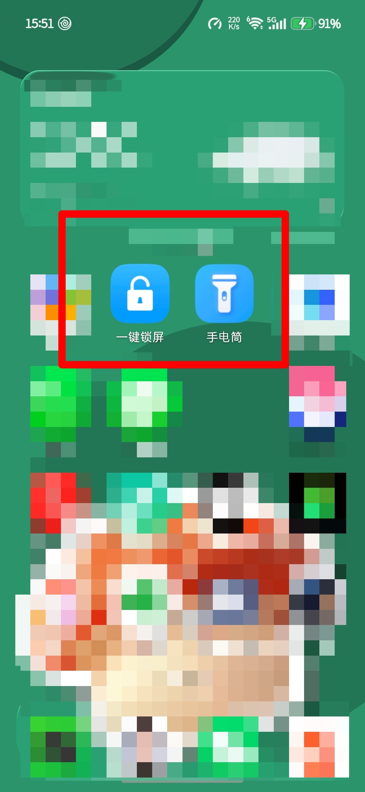
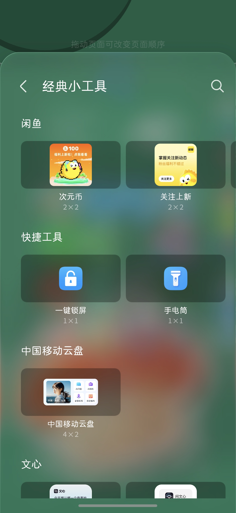

# 荣耀手机一键锁屏对应软件排查复盘

> 本页面内容由 AI 汇总生成，仅供参考。
> 如内容涉及侵权，请联系邮箱 **lin_yb@88.com**，核实后删除。

> 记录在荣耀 MagicOS 11 / HnLauncher6 上，用 PowerShell + adb 排查桌面「一键锁屏」图标来源与执行链路的完整过程。

## 结论

- 桌面图标由 `com.hihonor.android.launcher` 绘制、摆放和响应点击。
- 图标的 Intent 与快捷方式能力由 `com.android.systemui` 通过 `CREATE_SHORTCUT` 协议提供。
- 点击后执行的是 `com.android.systemui/com.hihonor.keyguard.onekeylock.shortcut.ApproachActivity`，真正锁屏由 SystemUI Keyguard 完成。
- 系统里不存在可卸载的独立「一键锁屏」应用；`pm list packages` 搜不到对应第三方包。

## 文档

- [完整排查复盘](docs/honor-lockscreen-review.md)

## 截图

## 排查要点

- 用 `logcat` 抓点击瞬间的 `START` 行，确认发起方是 Launcher、执行方是 SystemUI。
- 用 `dumpsys package`、`pm path` 核对组件声明与包归属。
- 用 `uiautomator dump` 定位图标节点，确认坐标与日志中的 `bnds` 一致。
- 区分 `am start` 模拟与真实点击：前者发起方是 shell，不能用来证明 Launcher 是发起方。
- `-f 268435456` 是 `FLAG_ACTIVITY_NEW_TASK`，只是对齐日志 flag，不是必需参数。

## 注意

不要对 `com.android.systemui` 执行 `disable-user` 或 `uninstall`，会破坏状态栏、通知栏和锁屏。不想要这个图标，长按移除即可。

## 免责声明

本仓库内容由个人笔记自动转换汇总而来，仅供技术参考，不构成任何设备配置建议。不同机型、系统版本和桌面版本的行为可能不同。