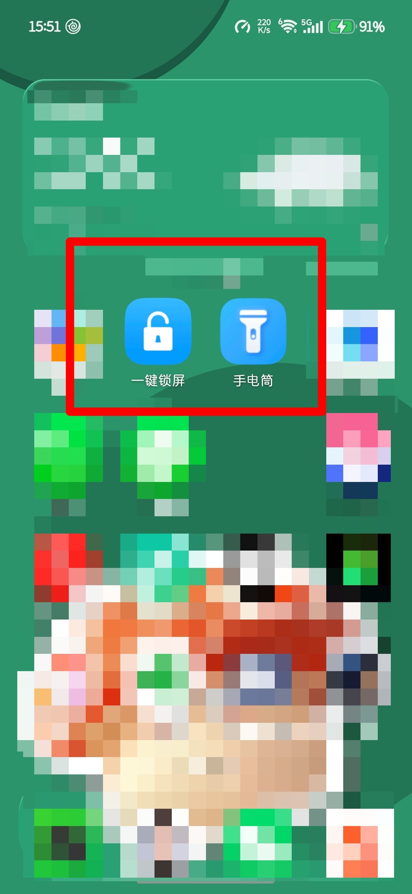
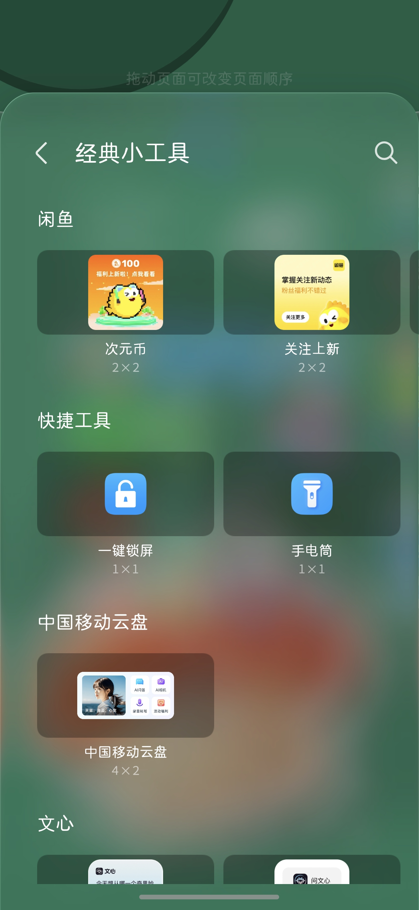

# 荣耀手机一键锁屏对应软件排查复盘

**背景**：荣耀手机（MagicOS 11 ，com.hihonor.* / HnLauncher6），USB 调试连接 Windows PowerShell。排查时间 2026-11-06 15:00–15:25。目标对象：桌面「一键锁屏」图标。

> 说明：下文「返回的关键结果」均摘自终端实际输出；PowerShell 控制台对长行做了视觉折行（例如 com.android.sy + stemui），此处按语义合并为一行，未改动字段名与数值。

------------------------------------------------------------------------

## 一、需求演进与排查思路（你的想法）

|  |  |
|----|----|
| 阶段 | 你当时的想法 / 目标 |
| 1 | 手机连着 adb，想知道点击桌面「一键锁屏」小部件，**实际执行了哪个包名的软件**；明确要求用 PowerShell + adb 命令查找 |
| 2 | 自己抓到 logcat 后，想**主动发一个 Intent 来模拟点击**，以此「验证是 Launcher 这个软件」 |
| 3 | 追问 am start -f 268435456 里那个数字是什么意思（不接受照抄命令，要理解参数） |
| 4 | 视角从「谁执行」转向「**图标本身**」：桌面这个图标是哪里来的、属于哪个软件包 |
| 5 | 贴出 dumpsys package 与 pm path 输出，继续确认图标来源与包归属 |
| 6 | 贴出 uiautomator dump 界面树，把证据链闭环 |

**贯穿始终的思路特点**：

- **从现象倒推本质**：不满足「点一下能锁屏」，一路追问「谁发起 → 谁执行 → 图标谁画 → 谁是包」。

- **只认可验证的证据**：每一轮都要求给出 adb / PowerShell 命令，用 logcat、dumpsys、pm、uiautomator 做交叉验证，不接受推测性结论。

- **对异常细节敏感**：xflg=0x4/0x5、日志里的 widget 字样、bnds 数值、魔法数字，都单独拎出来问。

------------------------------------------------------------------------

## 二、遇到的问题（坑、障碍、被修正的判断）

### 概念误导

1.  **「小部件」这个词本身就是误导**。日志 I Launcher : widget enter 和 widgetId 120 / 3865 让人以为是 AppWidget；dumpsys appwidget 实际查不到。bnds=[339,879][631,1214] ≈ 292×335，在 1264×2736 的 4×6 网格里是 **1×1 图标格子**。widgetId 120 属于 com.hihonor.parentcontrol，3865 是 YOYO 建议卡片（addWay=byUser、2×2），都跟一键锁屏无关。

<!-- -->

1.  **类名被误读成包名**。com.hihonor.keyguard.onekeylock.shortcut.ApproachActivity 看着像包名，其实 cmp= **斜杠前** com.android.systemui 才是包名，斜杠后是打进 SystemUI APK 的完整类名。系统里并没有 com.hihonor.keyguard 这个包。

<!-- -->

1.  **「应用」≠「包」**。SystemUI 是 /system/priv-app 的 persistent 特权系统组件，无 category.LAUNCHER Activity、无桌面图标、不可卸载；普通「应用管理」按可启动 / 可卸载过滤会把它剔除。

### 逻辑陷阱

1.  **「用** **am start** **模拟能证明发起方是 Launcher」是错的**。am start 的发起方是 com.android.shell（uid 2000），START 行会显示 from uid 2000，只能证明「这个组件能锁屏」。真正证明发起方的是点击日志里的 from uid 10120 (com.hihonor.android.launcher)。正确做法是 input tap 走完整链路，再看 START 的 from uid。

<!-- -->

1.  **两套「快捷方式」机制混淆**。dumpsys shortcut 管的是 ShortcutManager（API 25+ 的 App Shortcuts / pinned shortcut），而 android.intent.action.CREATE_SHORTCUT 是更早的 startActivityForResult 协议，两者互不相干。所以「确实是快捷方式，但 shortcut dump 为空」并不矛盾。

### 参数与环境

1.  **-f 268435456** **的含义**：= 0x10000000 = 2^28 = FLAG_ACTIVITY_NEW_TASK，Intent flags 是按位掩码，am -f 要传整数。写十进制是因为部分 Android 版本不解析 0x 前缀。**它不是必需的**——加上只为对齐日志的 flg=0x10000000；am start 走 system_server，不带也通常能启动。

<!-- -->

1.  **xflg** **与** **launchMode** **不是 flag**：xflg=0x4 → 0x5 是荣耀私有扩展位，标准 am 无法设置（不影响功能）；with LAUNCH_SINGLE_INSTANCE 是 manifest 的 launchMode，也不需要传。

<!-- -->

1.  **PowerShell 的坑**：中文输出乱码（需 [Console]::OutputEncoding = UTF8 + chcp 65001）；"package:\$pkg" 会被当成作用域变量，必须写 "package:\$(\$pkg)"；here-string 结束标记必须单独占行。沙箱侧没有手机和 adb，脚本只能静态检查、无法实机验证。

### 被修正的判断与访问边界

1.  **我自己的结论被修正**：最初判断为「桌面内置硬编码预置项、Intent 写在 launcher 里」；看到 CREATE_SHORTCUT filter 后修正为「**SystemUI 通过标准快捷方式协议提供 Intent 与图标资源，Launcher 负责生成、摆放、绘制**」。

<!-- -->

1.  **数据访问边界**：图标记录存在 /data/data/com.hihonor.android.launcher/databases/launcher.db，但 run-as 对系统 app 通常失败（非 debuggable），零售机 adb root 不可用，只能靠 dump 反推。

<!-- -->

1.  **界面树的边界**：图标节点是 android.widget.TextView，图标位图是 drawable（父容器 / 背景 / 复合图标），不在 XML 里 → **无法判定图标位图来自哪个 APK**；也无法区分「出厂预置」还是「用户自己从桌面小工具列表添加」。

------------------------------------------------------------------------

## 三、验证证明

### 3.1 实际输入的命令与返回的关键结果

#### A. 点击瞬间抓 logcat（阶段 2，主证据）

**输入的命令**

**返回的关键结果**

同一段里还有 HnAppRec 上报的 appWidgetInfo："widgetId":3865, "widgetSize":"2x2", "addWay":"byUser"，属于 YOYO 建议卡片，与一键锁屏无关。

**判读**：发起方 from uid 10120 (com.hihonor.android.launcher)，执行方 cmp=com.android.systemui/...，锁屏由 4499（SystemUI 进程）的 Keyguard 完成，:59.919 → :59.984 约 65ms；ApproachActivity 在 .951 就被移除，是透明中转。

#### B. 组件声明与包归属核对（阶段 5）

**输入的命令**

**返回的关键结果**

**判读**：三个 filter 全在 SystemUI 包内，且 Category 都是 DEFAULT（无 LAUNCHER → 应用抽屉无入口）；CREATE_SHORTCUT 解释了图标来源，也促成了「桌面硬编码预置」这一判断的修正。三条空输出排除了 AppWidget、pinned shortcut 和独立安装包。SystemUI 在 /system/priv-app（特权固化），Launcher 在 /data/app（可更新预装，带 LauncherPreloadPlugin 等 4 个 split/插件）。

#### C. 界面树定位图标（阶段 6，闭环证据）

**输入的命令**

**返回的关键结果**

**判读**：package="com.hihonor.android.launcher" → 图标 View 由桌面绘制；class=TextView、resource-id="" → 动态生成的带文字快捷方式，图标位图是 drawable 故不在 XML 里；bounds="[339,879][631,1214]" 与 A 组 logcat 的 bnds= **完全一致**，中心 (485,1046) 正是 input tap 485 1046，证据链闭合。

#### D. 直接发 Intent 模拟（阶段 2 / 3）

**输入的命令**

**返回的关键结果**

**判读**：组件 exported 且能从 shell UID 调起；-f 268435456 = FLAG_ACTIVITY_NEW_TASK，只用于对齐日志 flg=0x10000000，非必需。注意此路径的 START 行发起方会是 uid 2000 (com.android.shell)，**不能**用来证明「是 Launcher 发的」。

> 补充：find-lock-widget.ps1 / verify-onekeylock.ps1 两个脚本在沙箱中只做了语法检查，未在本机实机运行；上面的 A/B/C/D 全部来自你在 PowerShell 里实际敲的命令与回显。

### 3.2 证据链汇总

|  |  |  |  |
|----|----|----|----|
| # | 待证主张 | 关键证据（对应上面的返回） | 结论 |
| 1 | 点击的发起方 | A：I Launcher : widget enter（pid 13996 桌面）、START ... from uid 10120 (com.hihonor.android.launcher)、realCallingPackage / launchedFromPackage | **发起方 = 荣耀桌面** **com.hihonor.android.launcher** |
| 2 | 点击的执行方 | A：cmp=com.android.systemui/...ApproachActivity、start activity name = ...ApproachActivity、UsageStatsService 的 ComponentInfo | **执行组件在** **com.android.systemui** |
| 3 | 真正锁屏动作 | A：onStartedGoingToSleep reason:0 → onPendingLock → UNLOCKED->KEYGUARD → SCREEN_OFF → isKeyguardLocked true → t=SLEEP，约 65ms；.951 Remove activity client record | **锁屏由 SystemUI Keyguard 完成**，ApproachActivity 只是透明中转 |
| 4 | 无独立安装包 | B：三条排除命令均**无输出** | 不是第三方 app、不是 AppWidget、不是现代 pinned shortcut |
| 5 | 组件声明归属与入口能力 | B：三个 filter MAIN / VIEW / CREATE_SHORTCUT，Category 全 DEFAULT | SystemUI 提供创建快捷方式能力；无 LAUNCHER → 抽屉里没有入口 |
| 6 | 图标 View 归属 | C：package="com.hihonor.android.launcher"、clickable / long-clickable = true | **图标由桌面绘制**，可点可长按 |
| 7 | 坐标闭环 | C 的 bounds 与 A 的 bnds 完全一致，中心 (485,1046) | 那次点击确实落在这个 View 上，**证据链闭合** |
| 8 | 包路径与权限 | B：/system/priv-app/SystemUI/SystemUI.apk；/data/app/.../HnLauncher6.apk + 4 个 split/插件 | SystemUI 特权固化不可卸载；桌面是可更新预装应用 |
| 9 | Intent 模拟可行 | D：用户确认「这个可以」，成功锁屏 | 组件可从 shell 调起；-f 仅用于对齐日志 flag |

### 3.3 最终结论

|  |  |
|----|----|
| 层次 | 归属 |
| 图标 View（绘制 / 点击 / 长按） | **com.hihonor.android.launcher**（HnLauncher6.apk，含 LauncherPreloadPlugin） |
| 图标的 Intent、标签、可能的位图资源 | **com.android.systemui**（通过 CREATE_SHORTCUT 协议提供） |
| 点击后执行的组件 | com.android.systemui/com.hihonor.keyguard.onekeylock.shortcut.ApproachActivity |
| 真正锁屏 | SystemUI Keyguard → goToSleep → SCREEN_OFF |
| 独立 app / 第三方包 | **不存在**，pm list packages 搜不到 |

一句话：**桌面画图标，SystemUI 供功能，没有可卸载的「一键锁屏软件」**。

⚠️ 别对 com.android.systemui 执行 disable-user / uninstall，会毁掉状态栏、通知栏和锁屏；不想要图标，长按移除即可。

------------------------------------------------------------------------

## 四、遗留 / 未证实

- 图标**位图资源**具体在哪个 APK（界面树里是 TextView，drawable 不在 XML 中，需反编译 SystemUI / Launcher APK 查 res/）。

- xflg=0x4 → 0x5 增加的那一位具体语义（荣耀私有扩展，未公开）。

- 长按菜单实际内容只有「移除」（实测）。

------------------------------------------------------------------------

## 五、交付物与命令速查

**已生成的文件**（/workspace/）：

|  |  |
|----|----|
| 文件 | 用途 |
| find-lock-widget.ps1 | 5 步排查：环境检查 → dumpsys appwidget → 能力反查 → 交互式点击抓 logcat → device_policy / accessibility / pendingintents / 历史广播 → 汇总包名 |
| verify-onekeylock.ps1 | 4 步验证：身份核对 → uiautomator dump 定位并 input tap → am start 直调组件 → dumpsys power 状态检查 |

**核心命令速查**：

\# 编码

[Console]::OutputEncoding = [System.Text.Encoding]::UTF8; chcp 65001 | Out-Null

\# 小部件 / 组件能力

adb shell dumpsys appwidget | Select-String 'provider=|ComponentInfo'

adb shell pm query-receivers --brief -a android.appwidget.action.APPWIDGET_UPDATE

adb shell pm query-receivers --brief -a android.app.action.DEVICE_ADMIN_ENABLED

adb shell pm query-services  --brief -a android.accessibilityservice.AccessibilityService

\# 点击抓包

adb logcat -c

adb logcat -d -v threadtime | Select-String 'START u0|cmp=|APPWIDGET|SCREEN_OFF|Permission Denial'

\# 组件与包归属

adb shell dumpsys package \<包名> | Select-String 'ApproachActivity|onekeylock' -Context 0,2

adb shell pm list packages -s | Select-String 'systemui'

adb shell pm path \<包名>

\# 界面树与点击

adb shell uiautomator dump /sdcard/window.xml

\$xml = (adb shell cat /sdcard/window.xml) -join "`n"

[regex]::Matches(\$xml, '\<node[^>]*(?:content-desc|text)="[^"]*锁屏[^"]*"[^>]*>') | ForEach-Object { \$_.Value }

adb shell input tap 485 1046

adb shell input swipe 485 1046 485 1046 800      # 长按

\# 模拟 Intent 与状态

adb shell am start -n com.android.systemui/com.hihonor.keyguard.onekeylock.shortcut.ApproachActivity -f 268435456

adb shell dumpsys power | Select-String 'mWakefulness='

adb shell input keyevent 224                    # 唤醒

adb shell am start -a android.settings.APPLICATION_DETAILS_SETTINGS -d "package:\$(\$pkg)"

---
> 本页面内容由 AI 汇总生成，仅供参考。如内容涉及侵权，请联系邮箱 **lin_yb@88.com**，核实后删除。
